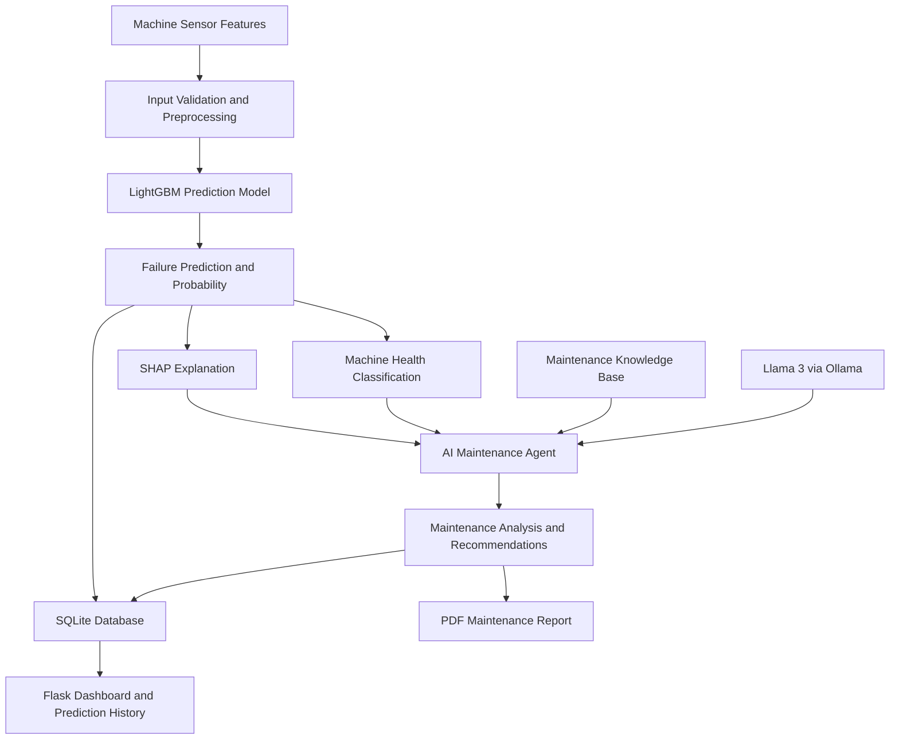

# AI-Powered Predictive Maintenance Agent for Industry 5.0

**An explainable machine-failure prediction and maintenance decision-support system using LightGBM, SHAP, and Llama 3.**

[](https://www.python.org/)
[](https://flask.palletsprojects.com/)
[](https://lightgbm.readthedocs.io/)
[](https://www.llama.com/)

## Overview

Machine failures can cause production downtime, maintenance expenses, and reduced equipment reliability. Traditional predictive maintenance systems primarily focus on identifying potential failures, while maintenance engineers also need understandable explanations and actionable recommendations.

This project develops an AI-assisted predictive maintenance system that combines machine-learning predictions, explainable AI, maintenance knowledge, and a large language model to support maintenance decisions.

The system uses **LightGBM** to estimate machine-failure risk, **SHAP** to explain model predictions, and **Llama 3 through Ollama** to generate human-readable maintenance analysis and recommendations. A Flask web application provides prediction results, machine-health status, historical records, a dashboard, and downloadable PDF maintenance reports.

## Key Features

- **Machine Failure Prediction:** Uses a trained LightGBM classification model to predict potential machine failures.
- **Explainable AI:** Uses SHAP to identify features influencing model predictions.
- **AI Maintenance Agent:** Uses Llama 3 through Ollama to interpret prediction results and generate maintenance recommendations.
- **Fallback Analysis:** Provides rule-based analysis when the local LLM is unavailable, where supported by the application.
- **Machine Health Classification:** Displays Healthy, Warning, or Critical status based on configured risk thresholds.
- **Maintenance Knowledge Base:** Uses stored maintenance knowledge to support recommendations.
- **Prediction History:** Stores prediction records in an SQLite database.
- **Interactive Dashboard:** Presents maintenance and prediction information through a web interface.
- **PDF Report Generation:** Generates downloadable maintenance reports.
- **Input Validation and Error Handling:** Helps handle invalid inputs and application errors.

## System Architecture



The LightGBM model performs failure prediction. SHAP explains the model output, while the maintenance knowledge base and Llama 3 support the generation of understandable maintenance guidance.

## Technology Stack

| Component | Technologies |
|---|---|
| Programming Language | Python 3.11 |
| Web Framework | Flask |
| Machine Learning | LightGBM, scikit-learn |
| Explainable AI | SHAP |
| Large Language Model | Llama 3 |
| Local LLM Runtime | Ollama |
| Data Processing | Pandas, NumPy |
| Model Serialization | Joblib |
| Database | SQLite |
| Frontend | HTML, CSS, Bootstrap, JavaScript |
| Visualization | Plotly |
| PDF Reports | ReportLab |
| Testing | Python test scripts |

## Dataset

This project uses the **AI4I 2020 Predictive Maintenance Dataset**, a benchmark dataset for machine predictive maintenance.

The dataset contains machine-operating measurements and a machine-failure target.

### Input Features

| Feature | Description |
|---|---|
| Product Type | Categorical product-quality/type indicator |
| Air Temperature | Ambient air temperature in Kelvin |
| Process Temperature | Process temperature in Kelvin |
| Rotational Speed | Rotational speed in revolutions per minute |
| Torque | Torque in Newton-metres |
| Tool Wear | Tool wear in minutes |

**Target variable:** Machine Failure.

The dataset is used for model development and evaluation. It does not represent live sensor readings from an actual factory in this implementation.

Dataset source: [AI4I 2020 Predictive Maintenance Dataset — UCI Machine Learning Repository](https://archive.ics.uci.edu/dataset/601/ai4i+2020+predictive+maintenance+dataset)

## How It Works

1. The user enters machine-operating parameters through the web interface.
2. The application validates and preprocesses the input.
3. The trained LightGBM model predicts whether machine failure is likely and provides a failure-risk estimate.
4. SHAP identifies influential features behind the model's prediction.
5. The health-classification service assigns a health status using configured thresholds.
6. The maintenance knowledge base supplies relevant maintenance information.
7. Llama 3 generates human-readable analysis and recommendations when available.
8. The application stores prediction records in SQLite.
9. Users can review results on the dashboard, inspect prediction history, and generate PDF reports.

## Getting Started

### Prerequisites

Install or prepare the following:

- Python 3.11
- Git
- Ollama, if you want to use the local Llama 3 model
- The project files and trained model artifacts

### 1. Clone the Repository

```bash
git clone https://github.com/Adharsh032/AI-Predictive-Maintenance.git
cd AI-Predictive-Maintenance
```

### 2. Create a Virtual Environment

**Windows PowerShell:**

```powershell
python -m venv venv
.\venv\Scripts\Activate.ps1
```

If PowerShell blocks environment activation, follow the official Python or PowerShell guidance for virtual environments.

### 3. Install Dependencies

```powershell
python -m pip install --upgrade pip
pip install -r requirements.txt
```

### 4. Configure the Environment

Review `.env.example` and `config.py`. Set any required local configuration values according to the project's implementation. Do not commit secrets or private credentials.

### 5. Set Up Ollama and Llama 3

Install Ollama from [ollama.com](https://ollama.com/), then download the model:

```powershell
ollama pull llama3
```

Ensure the Ollama service is running before testing LLM-powered analysis. The application's fallback behavior can be used when the LLM is unavailable, subject to the implemented configuration.

### 6. Run the Application

From the project root, with the virtual environment activated:

```powershell
python app.py
```

Open the local URL printed in the terminal, commonly:

```text
http://127.0.0.1:5000
```

Keep the Flask server running while using the application.

## Using the Application

1. Open the prediction page.
2. Enter the required machine parameters.
3. Submit the form to view the failure prediction and risk estimate.
4. Review the SHAP explanation and machine-health status.
5. Read the AI-generated or fallback maintenance analysis.
6. Visit the dashboard and history pages to review stored records.
7. Generate a PDF maintenance report when needed.

Actual page names and available actions depend on the current application implementation.

## Project Structure

```text
AI-Predictive-Maintenance/
├── app.py
├── config.py
├── requirements.txt
├── README.md
├── .env.example
├── data/
│   ├── raw/
│   └── processed/
├── database/
│   ├── db.py
│   ├── models.py
│   ├── check_db.py
│   └── test_models.py
├── models/
│   ├── lightgbm_model.pkl
│   ├── preprocessing.pkl
│   └── train_model.py
├── notebooks/
│   └── eda.py
├── reports/
│   └── eda/
├── routes/
│   ├── dashboard.py
│   ├── prediction.py
│   └── reports.py
├── services/
│   ├── ai_agent.py
│   ├── explanation_service.py
│   ├── health_service.py
│   ├── knowledge_base.py
│   ├── prediction_service.py
│   ├── preprocessing.py
│   └── report_service.py
├── templates/
│   ├── dashboard.html
│   ├── history.html
│   ├── history_detail.html
│   ├── predict.html
│   └── result.html
└── tests/
```

## Model Evaluation

The project uses the AI4I 2020 benchmark dataset for model development and evaluation.

Relevant evaluation measures include:

- Accuracy
- Precision
- Recall
- F1-score
- Confusion matrix
- ROC-AUC, where evaluated

Because machine-failure data can be imbalanced, failure-class recall and precision should be examined alongside accuracy.

**Evaluation results:** Add the actual measured metrics from your experiments here. Do not report unverified accuracy, model-comparison results, or performance claims.

## Limitations

- The current system uses a benchmark dataset rather than a live industrial sensor stream.
- Prediction quality depends on the dataset, preprocessing, and trained model.
- LLM-generated recommendations may be incomplete or incorrect and should be reviewed by a qualified maintenance professional.
- The system is a decision-support prototype, not a replacement for industrial safety procedures or expert inspection.
- Real-time IoT integration and production deployment require additional development and validation.

## Future Enhancements

- Integrate live sensor data and IoT devices.
- Evaluate LightGBM against baseline models using the same data split and metrics.
- Improve model monitoring and drift detection.
- Expand the maintenance knowledge base.
- Add authentication and role-based access control.
- Validate the system using real industrial data and maintenance feedback.
- Deploy the application in a suitable production environment after security and reliability testing.

## References

1. AI4I 2020 Predictive Maintenance Dataset, UCI Machine Learning Repository.
2. Ke, G. et al. “LightGBM: A Highly Efficient Gradient Boosting Decision Tree.” NeurIPS, 2017.
3. Lundberg, S. M., and Lee, S.-I. “A Unified Approach to Interpreting Model Predictions.” NeurIPS, 2017.
4. Meta AI. “The Llama 3 Herd of Models,” 2024.

## Author

**Adharsh Kumar**

B.Tech — Artificial Intelligence and Machine Learning

GitHub: [@Adharsh032](https://github.com/Adharsh032)

---

*This project is an academic prototype developed to explore explainable machine learning and LLM-assisted predictive maintenance for Industry 5.0.*
